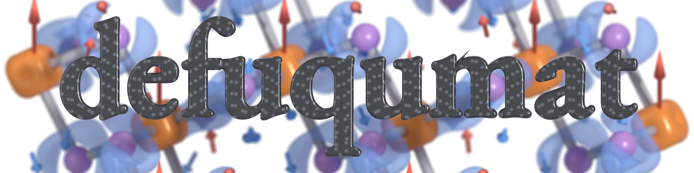

# defuqumat

This is a plane-wave density-functional theory code in Python. You run it with a
normal Quantum ESPRESSO `pw.x` input file. It computes the ground state, the band
structure and the density of states. It also computes forces, stress and relaxed
geometries, and the dielectric, vibrational and optical response. For magnetism,
it goes from a collinear moment to a spin spiral and a magnon. Some quantities
are not in [Quantum ESPRESSO](https://www.quantum-espresso.org) and not in
[Elk](https://elk.sourceforge.io), for example the Chern and $\mathbb Z_2$
invariants, the shift current, the Heisenberg exchange constants from a
spin-spiral scan, and the elastic constants. When Quantum ESPRESSO also computes
a number, we compared the two codes on the same input.

The user guide is at <https://joselado.github.io/defuqumat/>. It is also
available as a [PDF](https://joselado.github.io/defuqumat/user_guide.pdf).

## Installing

```bash
git clone https://github.com/joselado/defuqumat
cd defuqumat
pip install -e .
```

You need Python 3.10 or newer. The code uses JAX, NumPy, SciPy, Numba and
equinox, and `pip` installs them for you. If you want the plots and the
notebooks, use `pip install -e ".[notebooks]"`, which adds matplotlib and
Jupyter.

## A first calculation

This is silicon, with the input file from `benchmarks/`:

```python
from defuqumat import Calculator

calc = Calculator.from_file("benchmarks/si-1k.in", pseudo_dir="tests/data/pseudo")
result = calc.get_scf()

print(f"converged in {result.iterations} iterations")
print(f"total energy   {result.total_energy:.8f} Ry")
for name, value in result.energy_terms.items():
    print(f"  {name:<13} {value:>15.8f} Ry")
```

```
converged in 5 iterations
total energy   -15.25444866 Ry
  one-electron       5.26858903 Ry
  hartree            1.26263517 Ry
  xc                -4.88591428 Ry
  ewald            -16.89975858 Ry
```

The file `benchmarks/si-1k.in` is a normal `pw.x` input file. You can give any
`pw.x` input file to `Calculator.from_file`. The namelists `&control`, `&system`
and `&electrons` work in the same way as in Quantum ESPRESSO. The same is true
for the cards `ATOMIC_SPECIES`, `ATOMIC_POSITIONS` and `K_POINTS`. Also
`conv_thr` has the same meaning, so the SCF stops at the same point as in
`pw.x`. The pseudopotentials are UPF files. The code reads their names from the
`ATOMIC_SPECIES` card and looks for them in `pseudo_dir`. If you do not give
`pseudo_dir`, the code looks in the folder of the input file. So, to compute
your own crystal, you write an input file and put the UPF files in that folder.
Notebook [25](notebooks/25_your_own_crystal.ipynb) shows this step by step,
from the structure to the converged energy.

All other quantities are methods of the same object. Each method first runs the
SCF, if there is no SCF result stored yet:

```python
calc.get_forces()             # and get_stress(), get_relax(), get_dos()
calc.get_dielectric_tensor()  # and get_phonons(), get_raman_tensors()
calc.get_chern()              # and get_z2(), get_berry_curvature()
```

## A band structure

We continue from the density of the SCF:

```python
from defuqumat.system.kpoints import KPoints

path = KPoints.band_path(
    [[0.5, 0.5, 0.5], [0.0, 0.0, 0.0], [1.0, 0.0, 0.0]],   # L - Gamma - X
    [20, 20, 1], calc.system.cell, crystal=False,
)
bands = calc.get_bands(kpoints=path, nbnd=8)

print(f"indirect gap   {bands.gap(8):.3f} eV")
bands.plot()
```

The array `bands.eigenvalues_ev` has the shape `(k-points, bands)` and is in eV.
The array `bands.path_length` is the x-axis of the plot. The method
`bands.plot()` draws the bands, with the zero at the Fermi level of the SCF. The
gap is small because LDA underestimates gaps. This comes from the functional and
not from the code, and Quantum ESPRESSO gives the same gap.

## One calculation on many cores

The cores are shared over the k-points, in the same way as `pw.x -nk`. If you
set `DEFUQUMAT_POOLS`, one calculation runs as that number of processes. Each
process diagonalises its own part of the k-points, and you do not change the
script. Under Slurm, you launch it like this:

```bash
#SBATCH --signal=TERM@600
export DEFUQUMAT_POOLS=$SLURM_NTASKS DEFUQUMAT_THREADS=$SLURM_CPUS_PER_TASK
srun python3 run.py
```

The numbers are the same as with one process, up to round-off. The ground state,
forces, stress, relaxations, band structures, NSCF runs and densities of states
work in this way. The Newton solver
(`scf_solver='newton-krylov'`) also works, with its default Jacobian. Spin
spirals, magnetic fields and constrained moments also work. A checkpoint written
with pools can continue with any number of pools. A run with pools can also start
from the result of another run with pools. If the job gets a SIGTERM, all pools stop at the same
iteration and write a checkpoint. All other calculations give an error with
pools, and the error says which calculation it is. The speedups against
`pw.x -nk` are in [`PERFORMANCE.md`](PERFORMANCE.md).

## What you can compute

Everything starts from one functional. This is the Kohn-Sham total energy, as a
function of the wavefunctions, the atomic positions and the strain:

$$
E[\{\psi\},\boldsymbol\tau,\varepsilon] = T_s + E_{\mathrm H} + E_{xc}
  + E_{\mathrm{loc}} + E_{\mathrm{nl}} + E_{\mathrm{Ewald}}.
$$

Most of the quantities below are the minimum of this energy, or one of its
derivatives. The other ones are properties of the states at the minimum, for
example a tunnelling image or a structure factor. Each group starts with the
equation of its main quantity. Then it lists the other quantities, each with the
call or the input variable that computes it, and with a notebook that shows it
on a real crystal. Each quantity has some conditions: which pseudopotentials,
which spin regimes, and what it refuses. These conditions are in the "Limits" note
of each page of the [user guide](https://joselado.github.io/defuqumat/). The file
[`notebooks/README.md`](notebooks/README.md) lists the notebooks by the property
you want to compute.

### The ground state

These are the Kohn-Sham equations. We solve them self-consistently in a
plane-wave basis:

$$
H[n]\,\psi_{n\mathbf k} = \epsilon_{n\mathbf k}\,S\,\psi_{n\mathbf k},
\qquad
n(\mathbf r) = \sum_{n\mathbf k} f_{n\mathbf k}\,\lvert\psi_{n\mathbf k}(\mathbf r)\rvert^2
  + n_{\mathrm{aug}}(\mathbf r).
$$

For a norm-conserving pseudopotential, $S$ is the identity. For an ultrasoft or
PAW pseudopotential, $S$ is the overlap operator. In that case the soft
wavefunctions miss part of the density, and the augmentation charge
$n_{\mathrm{aug}}$ adds it back. The code gives the total energy and each of its
terms, for insulators and for metals. The occupations come from a smearing or
from the tetrahedron method, as the `occupations` variable says.
`calc.get_scf()`, notebooks [02](notebooks/02_silicon_scf_and_bands.ipynb) and
[25](notebooks/25_your_own_crystal.ipynb).

- **Band structure** along a path in the Brillouin zone. These are the
  $\epsilon_{n\mathbf k}$ at the converged density, with the Fermi level at zero.
  `calc.get_bands()`, notebook [02](notebooks/02_silicon_scf_and_bands.ipynb).
  For a density of states you need the eigenvalues on a denser grid at fixed
  density, and you get them with `calc.get_nscf()`.
- **Density of states**, $g(E) = \sum_{n\mathbf k} w_{\mathbf k}\,\delta(E - \epsilon_{n\mathbf k})$,
  with a smearing or with tetrahedra. `calc.get_dos()`, notebook
  [06](notebooks/06_density_of_states.ipynb).
- **Projected density of states**. This is the same sum, with each state
  weighted by $\lvert\langle\phi^{I}_{lm}\vert\psi_{n\mathbf k}\rangle\rvert^2$.
  So you can split it by atom and by $l$ and $m$. In a magnetic run you can also
  split it by spin channel, and in a spin-orbit run by $j$ and $m_j$. The Löwdin
  charges come with it. `calc.get_pdos()`, notebook
  [16](notebooks/16_projected_density_of_states.ipynb).
- **Band velocities**, $\mathbf v_{n\mathbf k} = \partial\epsilon_{n\mathbf k}/\partial\mathbf k$.
  They give the group velocity and the Drude weight.
  `calc.get_band_velocities()`, notebook [19](notebooks/19_linear_response.ipynb).
- **Effective mass tensor**, $(m^{\ast})^{-1}_{ij} = \partial^2\epsilon_{n\mathbf k}/\partial k_i\,\partial k_j$,
  at a k-point that you choose. You also get the principal masses and the
  density-of-states mass. `calc.get_effective_mass(kpoint)`, notebook
  [29](notebooks/29_effective_mass_and_angular_momenta.ipynb).
- **Starting from an all-electron ground state**. The code reads the converged
  density of Elk from its run directory and puts it on our grid as the starting
  density. This shows where the pseudopotential density can be different from
  the real one. `calc.get_elk_seed(directory)`, notebook
  [42](notebooks/42_all_electron_start.ipynb).

### Choosing the physics of the run

You choose the functional, the pseudopotentials and the Hubbard correction in
the input file, as in `pw.x`. The correction that changes the physics the most
is the onsite $U$. In the form of Dudarev it is

$$
E_U = \frac{U}{2}\sum_{I,\sigma}\mathrm{Tr}\bigl[\,n^{I\sigma}\,(1 - n^{I\sigma})\,\bigr].
$$

This is a penalty on a fractional occupation of the correlated shell. It pushes
the occupations to 0 and 1, and so it opens the gap of an oxide that LSDA gives
as a metal. On the same card you can also choose the full, rotationally
invariant form of Liechtenstein, with $J$. `HUBBARD` card, notebook
[13](notebooks/13_dft_plus_u.ipynb).

- **Pseudopotentials**: norm-conserving, ultrasoft and PAW, in UPF v2. The code
  reads the names from the card. `ATOMIC_SPECIES`, notebook
  [04](notebooks/04_ultrasoft_and_paw.ipynb).
- **Functionals**: LDA (Perdew-Zunger, Perdew-Wang) and GGA (PBE, revPBE,
  PBEsol). The code takes the functional from the header of the pseudopotential
  files, unless the input asks for another one. If a functional is not
  implemented, the code gives an error and does not use a different one.
  `input_dft`, notebook [05](notebooks/05_gradient_corrections.ipynb).
- **Band gaps from the Tran-Blaha potential**. This is the modified
  Becke-Johnson meta-GGA. It is a potential, and there is no energy functional
  behind it. For silicon it moves the gap from 0.49 eV in LDA to 1.13 eV, and
  the experimental gap is 1.17 eV. Forces, stress and response give an error,
  because the total energy is not variational. The topological invariants work
  with it. `input_dft = 'tb09'`, notebook
  [24](notebooks/24_tran_blaha_band_gaps.ipynb).
- **Tensor moments of the correlated shell**. The occupation matrix is written
  in an orthonormal basis of multipoles. In this basis the charge, the spin
  moment and $\mathbf L\cdot\mathbf S$ are single components. You can fix one of
  them, and so choose an orbital ordering. `TENSOR_MOMENTS` card.
- **Around-mean-field double counting**. This is the other choice besides the
  fully localised limit. The mean occupation of the shell is subtracted before
  the interaction, so a shell with uniform filling gets exactly no correction.
  `hubbard_double_counting = 'amf'`.
- **Slater integrals from the orbital**. The code computes $F^0$, $F^2$, $F^4$
  and $J$ from the radial function of the shell, with a screened Coulomb kernel.
  So you choose one $U$, and it fixes all of them, without an atomic table.
  `hubbard_slater = 'yukawa'`, notebook [13](notebooks/13_dft_plus_u.ipynb).
- **Van der Waals dispersion**, with the D2 pair sum of Grimme,
  $-s_6\sum_{I<J} C_6^{IJ}\,f_{\mathrm{damp}}(R_{IJ})\,R_{IJ}^{-6}$. It enters
  the energy, the forces, the stress and the elastic constants. It is what binds
  bilayer graphene, because PBE alone has no minimum there.
  `vdw_corr = 'grimme-d2'`, notebook [22](notebooks/22_van_der_waals.ipynb).
- **An electric field across a slab, and the dipole correction**. The field is a
  saw-tooth along one reciprocal vector, as in `pw.x`. The dipole correction
  cancels the artificial field that the dipole of a slab creates in the vacuum.
  The field enters the energy and the forces, so a relaxation in a field works.
  Phonons at Gamma work in the field too, and so does real-time propagation
  with the frozen potential.
  `tefield`, `dipfield`, notebook [53](notebooks/53_electric_field_molecule.ipynb).
- **A finite electric field in a crystal, by the Berry phase**. The code minimises
  the electric enthalpy $E_{\mathrm{KS}} - \mathbf E\cdot\mathbf P$, with
  $\mathbf P$ the Berry phase of the occupied bands. So it gives the polarization
  and the forces in the field, and $\varepsilon_\infty$ from the slope.
  `lelfield`, notebook [54](notebooks/54_finite_electric_field.ipynb).

### Structure and mechanics

The force on an atom is the derivative of the total energy with respect to its
position, at the converged wavefunctions:

$$
\mathbf F_I = -\frac{\partial E}{\partial \boldsymbol\tau_I}.
$$

At self-consistency this is exact, because the energy is stationary in the
wavefunctions. The unit is Ry/bohr. `calc.get_forces()`, notebook
[09](notebooks/09_forces_and_relaxation.ipynb). Its `.forces` has the shape
`(nat, 3)`.

- **Structural relaxation**. BFGS moves the atoms downhill until the forces are
  zero. In a **variable-cell relaxation**, the cell and the atoms move together,
  at a pressure that you choose. `calc.get_relax()` and
  `calc.get_relax(variable_cell=True)`, notebooks
  [09](notebooks/09_forces_and_relaxation.ipynb) and
  [23](notebooks/23_variable_cell_relaxation.ipynb).
- **Stress tensor and pressure**, $\sigma_{ij} = -\Omega^{-1}\,\partial E/\partial\varepsilon_{ij}$.
  This is the derivative of the energy with respect to strain, in Ry/bohr³ and
  in kbar. `calc.get_stress()`, notebook [15](notebooks/15_stress.ipynb).
- **The strain response**, $\partial\psi/\partial\varepsilon$ and
  $\partial n/\partial\varepsilon$. From them you get the deformation potentials
  $\partial\epsilon_{n\mathbf k}/\partial\varepsilon_{ij}$, which say how a
  strain moves a band edge. `calc.get_strain_response()`, notebook
  [21](notebooks/21_electrostriction.ipynb).
- **Elastic constants**, $C_{ijkl} = \partial\sigma_{ij}/\partial\varepsilon_{kl}$,
  with the compliances and the bulk modulus. The ions are clamped.
  `calc.get_elastic_constants()`, notebook
  [21](notebooks/21_electrostriction.ipynb).
- **Electrostriction and the elasto-optic tensor**. Electrostriction is the
  quadratic coupling between a field and a strain, with the coefficients $m$,
  $q$, $M$ and $Q$. The elasto-optic tensor is
  $\partial\chi_{ij}/\partial\varepsilon_{kl}$, so it says how a strain changes
  the dielectric response. This is why a crystal under strain becomes
  birefringent. `calc.get_electrostriction()`, notebook
  [21](notebooks/21_electrostriction.ipynb). Its `.photoelastic` is the
  elasto-optic tensor.
- **Piezoelectric tensor**, $e_{k,ij} = \partial P_k/\partial\varepsilon_{ij}$.
  This is the polarization that a strain creates. It is also the stress that a
  field creates. The ions are clamped. It is the proper tensor, so it also
  works for a polar crystal with a norm-conserving dataset.
  `calc.get_piezoelectric_tensor()`, notebook
  [28](notebooks/28_piezoelectricity.ipynb).

### Magnetism

A moment can be collinear (`nspin = 2`). It can also be a vector field with its
own magnetic symmetry group (`noncolin`), or be coupled to the orbital motion by
spin-orbit coupling (`lspinorb`). A spin spiral of any pitch runs in the unit
cell, without a supercell. To go from these runs to a spin model, we need the
exchange. We get it from the energy of a spiral as a function of its
wavevector:

$$
E(\mathbf q) - E(0) = m^2 \sum_{\mathbf R} J(\mathbf R)\,\bigl[1 - \cos(\mathbf q\cdot\mathbf R)\bigr].
$$

The code fits this over shells of neighbours. The residual of the fit tells you
how well a Heisenberg model describes the energy surface.
`calc.get_spiral_scan(wavevectors)`, notebook
[12](notebooks/12_spin_spirals.ipynb).

- **Collinear magnetism**, with one Fermi level or with two. You get two when
  `tot_magnetization` fixes the moment. A compensated magnet with sublattices
  related by a rotation, an altermagnet, can be written with one species.
  `nspin = 2`, notebook [07](notebooks/07_spin_polarization.ipynb).
- **Magnetism as a vector**,
  $\mathbf m(\mathbf r) = \sum_{n\mathbf k} f_{n\mathbf k}\,\psi^\dagger_{n\mathbf k}\,\boldsymbol\sigma\,\psi_{n\mathbf k}$,
  with the magnetic symmetry group. The gradient correction is built from
  $\nabla\mathbf m$ and not from $\nabla|\mathbf m|$. So it is smooth where the
  moment is zero, and it has no quantization axis. `noncolin`, notebooks
  [11](notebooks/11_noncollinear_magnetism_and_fields.ipynb) and
  [12](notebooks/12_spin_spirals.ipynb).
- **Spin-orbit coupling**, with two-component spinors and projectors resolved in
  $j$, from a fully relativistic pseudopotential. `lspinorb`, notebook
  [08](notebooks/08_spin_orbit_coupling.ipynb).
- **The moment on each atom**. This is the charge and the magnetization
  integrated in a sphere around each atom. You get it at convergence, and also
  at each iteration and each ionic step. With it you can tell a compensated
  magnet from the nonmagnetic state that it can fall into.
  `calc.get_scf().site_moments`, notebook
  [43](notebooks/43_magnetic_textures.ipynb).
- **Magnetic fields and constrained moments**. You can apply a uniform Zeeman
  field (`B_field`), or a field inside the sphere of one atom
  (`LOCAL_MAGNETIC_FIELDS` card). You can also hold a moment at a given size or
  direction, with a penalty or with a feedback field.
  `constrained_magnetization`, notebook
  [11](notebooks/11_noncollinear_magnetism_and_fields.ipynb).
- **Spin spirals** at any wavevector $\mathbf q$, with the generalized Bloch
  theorem. The up component is at $\mathbf k + \mathbf q/2$ and the down
  component at $\mathbf k - \mathbf q/2$. Symmetry is used, with the operations
  that leave $\mathbf q$ unchanged. With spin-orbit
  coupling the code gives an error, because spin-orbit coupling breaks the
  theorem. `spiral_q`, notebook [12](notebooks/12_spin_spirals.ipynb).
- **The Dzyaloshinskii-Moriya energy of a spin spiral**. We take the spiral
  computed without spin-orbit coupling and add spin-orbit coupling to first
  order, in the unit cell and at any $\mathbf q$. The result is
  $E_1(\mathbf q, \hat{\mathbf n}) = \hat{\mathbf n}\cdot\mathbf V(\mathbf q)$.
  It is odd in $\mathbf q$ and linear in the axis $\hat{\mathbf n}$ of the
  spiral. So one vector gives every orientation of the spiral plane, and it is
  zero in a centrosymmetric crystal. `calc.get_spiral_spin_orbit_energy()`,
  notebook [48](notebooks/48_spiral_chirality.ipynb).
- **Relaxing the spiral wavevector**. BFGS follows $\mathrm dE/\mathrm d\mathbf q$
  down to the pitch of the ground state. `calc.get_spiral_relaxation()`,
  notebook [14](notebooks/14_spiral_relaxation.ipynb).
- **Orbital, spin and total angular momentum on each atom**, $\langle L\rangle$,
  $\langle S\rangle$ and $\langle J\rangle$. This shows where the orbital moment
  of a spin-orbit magnet is. `calc.get_angular_momenta()`, notebook
  [29](notebooks/29_effective_mass_and_angular_momenta.ipynb).
- **Orbital magnetization of the cell**, $\mathbf M_{\mathrm{orb}}$, with the
  modern theory. This is the circulating part of the moment of a magnet, and no
  integral over the cell can give it. You need spin-orbit coupling, broken time
  reversal and a gap. `calc.get_orbital_magnetization()`, notebook
  [39](notebooks/39_orbital_magnetization.ipynb).
- **Magnetocrystalline anisotropy** with the force theorem,
  $E_{\mathrm{MAE}} = \sum_{\mathrm{occ}}\epsilon(\hat{\mathbf n}_1) - \sum_{\mathrm{occ}}\epsilon(\hat{\mathbf n}_2)$.
  The density is converged without spin-orbit coupling. Then the code does one
  diagonalisation per direction with spin-orbit coupling, and compares the sums
  of the band energies. `calc.get_anisotropy(spinor)`, notebook
  [36](notebooks/36_magnetic_anisotropy.ipynb). Here `spinor` is the same
  crystal as a spin-orbit calculator.
- **Relaxed magnetocrystalline anisotropy**. This is the same energy, but from
  total energies. The code does one self-consistent noncollinear run per
  direction, and the density can respond. It allows a Hubbard $U$, and it tells
  you how far each moment moved from its starting direction.
  `calc.get_relaxed_anisotropy()`, notebook
  [36](notebooks/36_magnetic_anisotropy.ipynb).
- **Magnetic torque**, $-\mathrm dF/\mathrm d\theta$. It gives the anisotropy
  from one angle, and not from the difference of two. For
  $E(\theta) = K_1\sin^2\theta$, the torque at 45 degrees is $-K_1$.
  `calc.get_torque(spinor)`, notebook
  [36](notebooks/36_magnetic_anisotropy.ipynb).
- **Easy orientation of a magnetic texture**, by relaxation and not by a scan.
  All spins turn with one rotation, and BFGS moves the rotation vector with this
  torque. This gives the easy axis of a magnet, and the plane of a spiral in a
  supercell. `calc.get_relaxed_orientation(spinor)`, notebook
  [47](notebooks/47_turning_a_magnet.ipynb). You can also do it inside a
  self-consistent run with `calc.get_scf(rotate_moments=True)`. Then the run
  converges to the easy orientation and does not wander around it. On a cell
  with inversion, `calc.with_turning_moments()` keeps that symmetry during the
  run.
- **Source-free exchange-correlation field, and its torque**. The code removes
  the longitudinal part of $\mathbf B_{xc}$, so that
  $\nabla\cdot\mathbf B_{xc} = 0$. Only with this can a local functional turn a
  moment at all. The integral $\int \mathbf m\times\mathbf B_{xc}$ tells you how
  far a texture is from a stationary state. `nosource`, and
  `calc.get_exchange_torque()` for the torque.
- **Magnons**. The code computes the transverse spin susceptibility
  $\chi^{+-}(\mathbf q,\omega)$. Its pole below the Stoner continuum of
  independent spin flips is the spin wave, and from it we get the dispersion
  $\omega(\mathbf q)$. The Goldstone theorem says $\omega(0) = 0$, so the value at
  zero is the error bar of the calculation.
  `calc.get_magnon_dispersion(qpoints, frequencies)`, notebook
  [38](notebooks/38_magnons.ipynb).

You give a magnetic texture one atom at a time, with `calc.with_moments()` or
with the `STARTING_MOMENTS` card. You need this for a helix, a cycloid or a Néel
state, and it decides the magnetic symmetry group. If the texture is not the
ground state, you can hold it fixed while the rest of the density relaxes
(`constrained_magnetization = 'atomic'` or `'atomic fsm'`). With
`calc.with_spin()`, a converged run can start another run with a different spin
regime. For example, a nonmagnetic density can start a magnetic run, or a
collinear run can start a noncollinear one. A long run writes checkpoints, so a
job that you submit again continues and does not start from zero. Notebooks
[17](notebooks/17_reaching_self_consistency.ipynb),
[18](notebooks/18_continuing_a_calculation.ipynb) and
[43](notebooks/43_magnetic_textures.ipynb).

### Vibrations and dielectric response

Here we apply a static electric field. With the ions fixed, the field creates a
polarization, and it also puts a force on each ion:

$$
\epsilon^{\infty}_{ij} = \delta_{ij} + 4\pi\,\frac{\partial P_i}{\partial \mathcal E_j},
\qquad
Z^{\ast}_{I,ij} = \frac{\partial F_{Ij}}{\partial \mathcal E_i}.
$$

The Born charge $Z^{\ast}$ is in units of the electron charge. Both are second
derivatives of the same energy with the same field, so one calculation gives
both. Infrared reflectivity measures $\epsilon^\infty$ above the phonon
frequencies. $Z^{\ast}$ is what splits the longitudinal and the transverse
optical modes of a polar crystal. This works for insulators.
`calc.get_dielectric_tensor()`, notebook
[19](notebooks/19_linear_response.ipynb). Its `.epsilon` has the shape `(3, 3)`
and its `.born_charges` the shape `(nat, 3, 3)`.

- **Phonons at $\Gamma$**. The code computes the force constants
  $C_{I\alpha,J\beta} = \partial^2 E/\partial\tau_{I\alpha}\,\partial\tau_{J\beta}$
  and the frequencies of the modes at the zone centre. These are the eigenvalues
  of $C_{I\alpha,J\beta}/\sqrt{M_I M_J}$, in cm⁻¹, and an unstable mode comes as
  a negative number. It works for insulators and metals, and for `nspin = 2`. An ultrasoft or PAW
  metal works with `nosym` and one spin channel. `calc.get_phonons()`,
  notebook [20](notebooks/20_phonons.ipynb). Its `.frequencies` has the shape
  `(3 nat,)`.
- **Phonons at $\mathbf q \neq 0$**. This is the dynamical matrix at one
  wavevector, so you get a frequency anywhere in the zone without a supercell.
  `calc.get_phonons_at_q(q)`, notebook [20](notebooks/20_phonons.ipynb).
- **Electron-phonon coupling** in a metal. The code computes the matrix elements
  $g_{mn}^\nu(\mathbf k, \mathbf q) = \langle\psi_{m\mathbf k+\mathbf q}|\partial_\nu V|\psi_{n\mathbf k}\rangle$.
  From them it gets the phonon linewidth $\gamma_{\mathbf q\nu}$, which you can
  measure with inelastic neutron or x-ray scattering. It also gets the
  dimensionless coupling $\lambda_{\mathbf q\nu}$, and its average over the zone
  enters $T_c$. You get them for a list of broadenings of the Fermi surface.
  `calc.get_electron_phonon(q)`, notebook
  [49](notebooks/49_electron_phonon.ipynb).
- **Raman tensors**, $\partial\epsilon_{ij}/\partial\tau_{I\alpha}$. They say how
  the dielectric tensor changes when an atom moves. `calc.get_raman_tensors()`,
  notebook [26](notebooks/26_raman_and_infrared_spectra.ipynb).
- **Raman and infrared spectra**. For each mode, the code contracts the Raman
  tensors and the Born charges with the eigenvectors. This gives the activity and
  the depolarisation ratio of each mode, which is what a spectrum shows.
  `calc.get_vibrational_spectrum()`, notebook
  [26](notebooks/26_raman_and_infrared_spectra.ipynb).
- **LO-TO splitting and the static dielectric constant**,
  $\epsilon^0_{ij} = \epsilon^\infty_{ij} + (4\pi e^2/\Omega)\sum_\nu p^\nu_i p^\nu_j/\omega_\nu^2$.
  A polar mode creates a macroscopic field. This field pushes the longitudinal
  branch up, and it also screens a static field. The Lyddane-Sachs-Teller
  relation connects the two.
  `calc.get_vibrational_spectrum(loto_direction=...)`, notebook
  [26](notebooks/26_raman_and_infrared_spectra.ipynb).

### Optical and nonlinear response

This is the absorption spectrum of an insulator, with the exciton bound below the
gap, from time-dependent density-functional theory. A metal with smearing
works too, and then the spectrum has the Drude term. The response of the
interacting electrons comes from a Dyson equation on top of the
independent-particle response:

$$
\chi(\omega) = \chi_0(\omega) + \chi_0(\omega)\,\bigl[v + f_{xc}(\omega)\bigr]\,\chi(\omega).
$$

Local-field effects are included. The spectrum is
$\mathrm{Im}\,\epsilon_M(\omega)$, where the macroscopic dielectric function
$\epsilon_M$ is the inverse of the head of $\epsilon^{-1}$. The bootstrap kernel
has no free parameter. It binds the exciton, and no adiabatic local kernel can do
this. `calc.get_absorption(frequencies)`, notebook
[27](notebooks/27_excitons_and_tddft.ipynb).

- **Optical conductivity**, $\sigma_{ab}(\omega)$, interband plus a Drude term.
  Its antisymmetric part needs both magnetism and spin-orbit coupling. It gives
  the magneto-optical **Kerr angle** and the **anomalous Hall conductivity**.
  `calc.get_optical_conductivity()`, notebook
  [30](notebooks/30_magneto_optics.ipynb).
- **Shift current**, $\sigma^{abc}(0;\omega,-\omega)$, the bulk photovoltaic
  effect. A crystal without an inversion centre carries a direct current under
  uniform light, with no junction and no built-in field.
  `calc.get_shift_current()`, notebook [32](notebooks/32_shift_current.ipynb).
- **Second-harmonic generation**, $\chi^{(2)}_{abc}(-2\omega;\omega,\omega)$. It
  says how much of the light on a crystal comes back at twice the frequency. It
  is a polar tensor of rank 3, so it is zero in any centrosymmetric crystal.
  `calc.get_shg()`, notebook [33](notebooks/33_second_harmonic_generation.ipynb).
- **High-harmonic generation**. A crystal driven by a strong laser emits light at
  multiples of the laser frequency. The code propagates the occupied states in
  time under $H(\mathbf k + \mathbf A(t)/c)$. In silicon you get a plateau of odd
  harmonics, and in zincblende AlAs you get all orders. On the way, a kick gives
  the dielectric function. The potential can stay at the ground state, or the
  Hartree and exchange-correlation potentials can be rebuilt from the density at
  each step (`potential = 'hxc'`). `calc.get_hhg(pulse)`, and
  `calc.get_realtime(pulse)` for the current in time; notebook
  [50](notebooks/50_high_harmonics.ipynb).
- **The third harmonic**, $\chi^{(3)}(-3\omega;\omega,\omega,\omega)$, and the
  intensity-dependent index $\chi^{(3)}(-\omega;\omega,\omega,-\omega)$, at one
  frequency or as a spectrum over many frequencies.
  `calc.get_third_harmonic(frequency)` and
  `calc.get_nonlinear_spectrum(frequencies)`, notebook
  [51](notebooks/51_nonlinear_spectra.ipynb).

### Topology and polarization

This is the Berry curvature of the occupied bands, and its integral over the
zone:

$$
\Omega_z(\mathbf k) = \nabla_{\mathbf k}\times \mathbf A(\mathbf k),
\qquad
\mathbf A(\mathbf k) = i\sum_{n\,\mathrm{occ}} \langle u_{n\mathbf k}\rvert\nabla_{\mathbf k} u_{n\mathbf k}\rangle,
\qquad
C = \frac{1}{2\pi}\int_{\mathrm{BZ}} \Omega_z(\mathbf k)\, d^2k.
$$

The Chern number $C$ is an integer. It counts the chiral edge states of a
two-dimensional insulator, and it gives the quantized Hall conductance,
$\sigma_{xy} = C\,e^2/h$. The code gives an exact integer on any k-mesh. So the
mesh only sets the resolution of the curvature map, and not the answer.
`calc.get_chern()`, and `calc.get_berry_curvature()` for the map; notebook
[10](notebooks/10_topological_invariants.ipynb).

- **$\mathbb Z_2$ invariants** in 2D and 3D. The code computes them in two
  independent ways, with the flow of the Wannier charge centres and with the
  Fu-Kane parities, and the two must agree. `calc.get_z2()` and
  `calc.get_z2_3d()`, notebook [10](notebooks/10_topological_invariants.ipynb).
- **Berry-phase polarization**. This is the phase of King-Smith and Vanderbilt
  along one reciprocal lattice vector,
  $\phi = -\,\mathrm{Im}\ln\prod_{j}\det\langle u_{n\mathbf k_j}\vert u_{m\mathbf k_{j+1}}\rangle$.
  The code also gives the quantum that it is defined modulo. You can get a Born
  charge from a displacement. `calc.get_polarization()`, notebook
  [34](notebooks/34_electric_polarization.ipynb).
- **Magnetoelectric tensor**, $\alpha_{ij} = \partial P_i/\partial B_j$. This is
  the polarization that a magnetic field creates, with the ions clamped. You need
  spin-orbit coupling, a gap and a crystal without an inversion centre.
  `calc.get_magnetoelectric_tensor()`, notebook
  [35](notebooks/35_magnetoelectric_effect.ipynb).

### Fermi surface, diffraction and tunnelling

What does a scanning-tunnelling microscope see? In the Tersoff-Hamann picture,
it sees the local density of states at the tip, integrated over the bias
window:

$$
I(\mathbf r, V) \propto \int_{E_F}^{E_F + eV} \rho(\mathbf r, E)\,\mathrm dE,
\qquad
\rho(\mathbf r, E) = \sum_{n\mathbf k} w_{\mathbf k}\,\lvert\psi_{n\mathbf k}(\mathbf r)\rvert^2\,\delta(E - \epsilon_{n\mathbf k}).
$$

You get the image at constant height or at constant current. A magnetic tip sees
$[\rho + P\,\hat{\mathbf n}\cdot\mathbf m]/2$ instead. So in a noncollinear
crystal, the image depends on the direction of the tip. `calc.get_stm()`,
notebook [40](notebooks/40_stm_images.ipynb).

- **Tunnelling spectra**, $\mathrm dI/\mathrm dV(\mathbf r, V)$. This is the same
  sum, but at one point and for many biases, and not as one picture at one bias.
  With it you can see a gap, a band edge or a state inside a gap. $I(V)$ comes
  with it. `calc.get_sts()`, notebook
  [45](notebooks/45_imaging_a_modulation.ipynb).
- **Vertical tunnelling transport through a 2D material**,
  $T(\mathbf r;E) = \int_{\mathrm{plane}} \lvert G(\mathbf r,\mathbf r';E)\rvert^2\,\mathrm d^2r'$.
  An electron enters at a point above the sheet and leaves into the plane below.
  So the current comes from the nonlocal Green's function between the two
  points, and not from the density of states at the tip. Each electrode can be
  magnetic, and then the map is a tunnelling magnetoresistance image.
  `calc.get_vertical_transport()`, notebook
  [41](notebooks/41_vertical_transport.ipynb).
- **Which k-points the tunnelling current comes from**. This is the same
  junction with a flat tip, so the map becomes one weight per $\mathbf k$. A
  state at large $\lvert\mathbf k_\parallel\rvert$ decays as
  $e^{-\sqrt{\kappa_0^2 + k_\parallel^2}\,z}$. So a pocket at the zone corner can
  hold most of the Fermi surface, and still carry little of the current.
  `calc.get_momentum_transport()`.
- **Fermi-surface nesting function**,
  $N(\mathbf q) = \sum_{\mathbf k}\delta(\epsilon_{\mathbf k} - E_F)\,\delta(\epsilon_{\mathbf k+\mathbf q} - E_F)$.
  It says how much of the Fermi surface falls on itself after a shift by
  $\mathbf q$. At such a $\mathbf q$ a phonon can soften, a charge-density wave
  can open a gap, or a spin spiral can find its pitch. `calc.get_nesting()`,
  notebook [31](notebooks/31_fermi_surface_nesting.ipynb).
- **X-ray and magnetic structure factors**,
  $F(\mathbf H) = \int_\Omega n(\mathbf r)\,e^{i\mathbf H\cdot\mathbf r}\,\mathrm d^3r$,
  and the same for $\mathbf m$. A diffraction experiment measures these Fourier
  coefficients, and not the density itself. Only the valence electrons are
  included. So a forbidden reflection, like the (222) of silicon, comes only
  from the bonding charge. `calc.get_structure_factors()`, notebook
  [37](notebooks/37_structure_factors.ipynb).

### Long-range modulations

Here the density or the potential changes over tens or hundreds of unit cells.
We solve this with the states of the unit cell, at the k-points that fold onto
the long cell:

$$
\Psi(\mathbf r) = \sum_{\mathbf k \in \mathcal K_N}\ \sum_{n=1}^{n_{\mathrm{bnd}}} c_{n\mathbf k}\,\psi_{n\mathbf k}(\mathbf r).
$$

Here $\mathcal K_N$ are the $N$ k-points of the unit cell that fold onto the
$\Gamma$ point of the supercell with $N$ cells. So the cost depends on the
number of bands, and not on the number of plane waves. This is a variational
truncation of the exact supercell. When `nbnd` grows, it converges to the
supercell from above. So the energy per unit cell tells you, with its sign,
whether a modulated state is better than the uniform one. An applied field
drives a modulation, and the code gives back the susceptibility resolved in
$\mathbf Q$. You can also start the loop from a seed, for example a texture, a
staggered wave or a helix. If the seed is a solution, the loop keeps it.
`calc.get_ultracell(supercell)`, notebooks
[44](notebooks/44_ultra_long_range.ipynb) and
[46](notebooks/46_a_spin_wave_that_stays.ipynb). Its `.total_energy` is the
energy per unit cell.

- **What a modulation looks like to a tip**. For an ultracell you get the
  Tersoff-Hamann image, the tunnelling spectrum and the vertical transmission.
  This is how you see a charge or spin density wave in practice. A tip without
  spin polarization sees the square of a spin density wave, so at twice the
  wavevector. A magnetic tip sees the wave itself. `calc.get_ultracell_stm()`,
  `calc.get_ultracell_sts()` and `calc.get_ultracell_transport()`, notebook
  [45](notebooks/45_imaging_a_modulation.ipynb).

## Which of these Quantum ESPRESSO and Elk also compute

Each row of the table is a quantity from the list above. It gives the call or the
input variable for it, and it says if the two established codes also compute it.
**QE** is Quantum ESPRESSO (`pw.x` and its post-processing tools), and **Elk** is
the all-electron LAPW code. A tick means that the code has the quantity, and
**(✓)** means that it has only part of it. **If both columns are empty, neither
code computes the quantity.** So you can see which rows are a reimplementation
and which rows are new. Each numbered mark is explained in
[`docs/reference-codes.md`](docs/reference-codes.md), with the routine or the
task of the other code that it refers to.

| Quantity | How to ask for it | QE | Elk |
|---|---|:-:|:-:|
| **Total energy**, self-consistent and term by term | `calc.get_scf()` | ✓ | ✓ |
| **A mixing mode for hard cells**: it chooses the preconditioner and checks every step | `get_scf(mixing_mode='robust')` | | |
| **Band structure** | `calc.get_bands()` | ✓ | ✓ |
| **Density of states** | `calc.get_dos()` | ✓ | ✓ |
| **Projected density of states**, by atom, $l$, $m$ and $j$ | `calc.get_pdos()` | ✓ | (✓)¹ |
| **Band velocities** | `calc.get_band_velocities()` | (✓)² | |
| **Effective mass tensor** | `calc.get_effective_mass(kpoint)` | | ✓ |
| **Starting from an all-electron ground state**³ | `calc.get_elk_seed(directory)` | | |
| **Pseudopotentials**: norm-conserving, ultrasoft and PAW | `ATOMIC_SPECIES` | ✓ | |
| **Functionals**: LDA, PBE, revPBE and PBEsol | `input_dft` | ✓ | ✓ |
| **Band gaps from the Tran-Blaha potential** | `input_dft = 'tb09'` | (✓)⁴ | ✓ |
| **DFT+U**, Dudarev's and Liechtenstein's functionals | `HUBBARD` card | ✓ | ✓ |
| **Tensor moments of the correlated shell** | `TENSOR_MOMENTS` card | | ✓ |
| **Around-mean-field double counting** | `hubbard_double_counting = 'amf'` | | ✓ |
| **Slater integrals from the orbital** | `hubbard_slater = 'yukawa'` | | ✓ |
| **Van der Waals dispersion**, Grimme's D2 | `vdw_corr = 'grimme-d2'` | ✓ | |
| **An electric field across a slab**, and the dipole correction, phonons at Gamma in the field | `tefield`, `dipfield` | ✓ | (✓)²⁰ |
| **A finite electric field in a crystal**, by the Berry phase | `lelfield` (norm-conserving, ultrasoft and PAW), `efield_cart` on an automatic mesh, `calc.get_scf().berry_dipoles` | ✓ | |
| **Forces on the atoms** | `calc.get_forces()` | ✓ | ✓ |
| **Structural relaxation** | `calc.get_relax()` | ✓ | ✓ |
| **Variable-cell relaxation** at an applied pressure | `calc.get_relax(variable_cell=True)` | ✓ | ✓ |
| **Stress tensor and pressure** | `calc.get_stress()` | ✓ | ✓ |
| **The strain response** and the deformation potentials | `calc.get_strain_response()` | | |
| **Elastic constants** | `calc.get_elastic_constants()` | | |
| **Electrostriction coefficients** | `calc.get_electrostriction()` | | |
| **Elasto-optic tensor** | `calc.get_electrostriction().photoelastic` | | |
| **Piezoelectric tensor** | `calc.get_piezoelectric_tensor()`, `calc.get_piezoelectric_kmesh_ladder()` | | ✓ |
| **Collinear magnetism**, with one Fermi level or two | `nspin = 2` | ✓ | ✓ |
| **Magnetism as a vector**, with the magnetic symmetry group | `noncolin` | ✓ | ✓ |
| **Spin-orbit coupling** | `lspinorb` | ✓ | ✓ |
| **The moment on each atom** | `calc.get_scf().site_moments` | ✓ | ✓ |
| **Magnetic fields and constrained moments** | `constrained_magnetization` | ✓ | ✓ |
| **Magnetic fields inside one atom's sphere**, and a fading field | `LOCAL_MAGNETIC_FIELDS` card | | ✓ |
| **Spin spirals** at any wavevector | `spiral_q` | | ✓ |
| **Relaxing the spiral wavevector** | `calc.get_spiral_relaxation()` | | |
| **$E(\mathbf q)$ and the Heisenberg exchange constants** | `calc.get_spiral_scan(wavevectors)` | | |
| **Dzyaloshinskii-Moriya energy of a spin spiral**, spin-orbit coupling to first order | `calc.get_spiral_spin_orbit_energy()` | | |
| **Orbital, spin and total angular momentum on each atom** | `calc.get_angular_momenta()` | (✓)⁵ | ✓ |
| **Orbital magnetization of the cell** | `calc.get_orbital_magnetization()` | ✓ | ⁶ |
| **Magnetocrystalline anisotropy**, by the force theorem | `calc.get_anisotropy(spinor)`, `calc.get_force_theorem(spinor)`, `calc.get_first_order_soc(spinor)` | ✓ | (✓)⁷ |
| **Relaxed magnetocrystalline anisotropy** | `calc.get_relaxed_anisotropy()` | (✓)⁸ | ✓ |
| **Magnetic torque** | `calc.get_torque(spinor)` | | |
| **Easy orientation of a magnetic texture**, relaxed | `calc.get_relaxed_orientation(spinor)`, `calc.get_orientation_torque(spinor)` | (✓)⁸ | (✓)⁷ |
| **Source-free exchange-correlation field**, and its torque | `calc.get_exchange_torque()` | | ✓ |
| **Magnons** and the transverse spin susceptibility | `calc.get_magnon_dispersion(qpoints, frequencies)`, `calc.get_spin_susceptibility(q, frequencies)` | (✓)⁹ | ✓ |
| **Dielectric constant** and **Born effective charges** | `calc.get_dielectric_tensor()`, `calc.get_born_charges()` | ✓ | ✓ |
| **Phonons at $\Gamma$** | `calc.get_phonons()` | ✓ | ✓ |
| **Phonons at $\mathbf q \neq 0$** | `calc.get_phonons_at_q(q)` | ✓ | ✓ |
| **Electron-phonon coupling**: phonon linewidths and $\lambda_{\mathbf q\nu}$ | `calc.get_electron_phonon(q)` | ✓ | (✓)¹⁸ |
| **Raman tensors** | `calc.get_raman_tensors()` | (✓)¹⁰ | |
| **Raman and infrared spectra** | `calc.get_vibrational_spectrum()` | ✓ | |
| **LO-TO splitting and the static dielectric constant** | `calc.get_vibrational_spectrum(loto_direction=...)` | ✓ | (✓)¹¹ |
| **Optical absorption spectra with excitons** | `calc.get_absorption(frequencies)` | | ✓ |
| **Optical conductivity**, the Kerr angle and the anomalous Hall conductivity | `calc.get_optical_conductivity()` | (✓)¹² | ✓ |
| **Shift current** | `calc.get_shift_current()` | ¹³ | |
| **Second-harmonic generation** | `calc.get_shg()` | (✓)¹⁴ | ✓ |
| **Real-time response to a laser pulse**: the current in time, the dielectric function from a kick, the high-harmonic spectrum | `calc.get_realtime(pulse)`, `calc.get_realtime_dielectric()`, `calc.get_hhg(pulse)` | | (✓)¹⁹ |
| **Third-harmonic susceptibility** $\chi^{(3)}$, at one frequency or as a spectrum | `calc.get_third_harmonic(frequency)`, `calc.get_harmonic_orders(frequency)` | | |
| **Berry curvature and Chern numbers** | `calc.get_chern()`, `calc.get_chern(spin=0)` at `nspin = 2` | | |
| **$\mathbb{Z}_2$ invariants** in 2D and 3D | `calc.get_z2()` | | |
| **Berry-phase polarization** | `calc.get_polarization()` | ✓ | ✓ |
| **Magnetoelectric tensor** | `calc.get_magnetoelectric_tensor()` | | ✓ |
| **Scanning-tunnelling microscopy images** | `calc.get_stm()` | (✓)¹⁵ | (✓)¹⁵ |
| **Tunnelling spectra** $\mathrm{d}I/\mathrm{d}V$ | `calc.get_sts()` | | |
| **Vertical tunnelling transport through a 2D material** | `calc.get_vertical_transport()` | (✓)¹⁶ | |
| **Which k-points the tunnelling current comes from**¹⁷ | `calc.get_momentum_transport()` | | |
| **Fermi-surface nesting function** | `calc.get_nesting()` | | ✓ |
| **X-ray and magnetic structure factors** | `calc.get_structure_factors()` | | ✓ |
| **Ultra long-range modulations**, the ultracell | `calc.get_ultracell(supercell)` | | ✓ |
| **The energy of a long-range modulation** | `calc.get_ultracell(supercell).total_energy` | | |
| **What a modulation looks like to a tip** | `calc.get_ultracell_stm()` | | |

Each row also has variants, for example which smearing or tetrahedron method
gives the occupations, which projectors DFT+U uses, or which constraint holds a
moment. You choose them with the same input variables as in `pw.x`, when `pw.x`
has them.

## Is it right?

This is the main question of the project. When Quantum ESPRESSO computes the
same quantity, we run the same input in both codes and compare the numbers:

| | agrees to |
|---|---|
| total energy, silicon, term by term | 1e-9 Ry |
| band structures | 0.0002 eV |
| forces, term by term | 2e-5 Ry/bohr |
| stress | 2.7e-7 Ry/bohr³ |
| the dielectric constant, and the Born effective charges | 1.2e-4; every digit `ph.x` prints |
| phonons at $\Gamma$, silicon and a metal | 0.05 and 0.002 cm⁻¹ |

The numbers for each feature are on the [Accuracy](https://joselado.github.io/defuqumat/accuracy/)
page of the user guide. This includes ultrasoft and PAW, the
functionals, spin and spin-orbit coupling, DFT+U, relaxation, the Raman and
infrared spectra, and the rest.

If neither code computes a quantity, there is no reference to compare with. So
we check it against a condition that the answer must satisfy, independent of
how we computed it. For example, a Chern number must be an exact integer. A spin
spiral must give the same result as a supercell calculation of the same
magnetic order, and it does, to 1e-12 Ry. A derivative must agree with a finite
difference of the quantity. If another code computes the quantity, we compare
with that code. For example, the exciton peak of LiF is at 14.05 eV, and Elk
gives 13.67 eV in its own example. If there is a second, independent way to
compute the same number, we compute it in both ways and compare.

## What it refuses, and what it does not do

**If something is not implemented, the code stops with an error that says what
is missing.** It does not silently replace it with something else. This is true
for combinations of features too. So if a run starts, all its physics is there.
The refusals of each quantity are in the amber boxes of the user guide.

**Not yet implemented:** the phonon dispersion and exact exchange. Phonons at
one wavevector work, but the star of $\mathbf q$ and the Fourier interpolation
between wavevectors do not.

**Replaced with a warning, and not refused:** a `K_POINTS gamma` input runs. For
an ultrasoft or PAW pseudopotential, for a run with symmetry, or for a spinor or
spiral run, the code computes it as an explicit k = 0 and says so. This is the
same physics, and it agrees to round-off.

If your calculation needs any of these, use Quantum ESPRESSO. This code does not
replace it, and on one core it is slower. One SCF iteration takes about 2.2
times longer, as the median over ten cases with different physics. Across the
cases the factor goes from 1.3 to 3.5. We measured this against a `pw.x` linked
to an optimised BLAS ([`PERFORMANCE.md`](PERFORMANCE.md)).

## Where to read more

- The [user guide](https://joselado.github.io/defuqumat/) (also as a
  [PDF](https://joselado.github.io/defuqumat/user_guide.pdf)) shows how to compute
  each quantity. For each one it gives the equation, a snippet that runs it with
  its output, a figure, and what it refuses. The source is `docs/guide/`, and
  `mkdocs serve` shows it locally.
- [`notebooks/README.md`](notebooks/README.md) lists the worked examples by the
  property you want to compute. Each notebook is run and saved with its output,
  so you can read it without running it. Start with `00_the_calculator` and
  `25_your_own_crystal`.
- `benchmarks/` has input files that are ready to run, from a silicon cell with
  two atoms up to one with sixteen atoms.
  [`performance/README.md`](performance/README.md) explains how to run the same
  inputs with `pw.x` and with this code, side by side.
- The tests compare against the reference outputs of the test suite of Quantum
  ESPRESSO. Run them with `pip install -e ".[dev]"` and
  `python3 -m pytest`. If that directory is not there, those tests are skipped.

## License

GPL v3 or later, see [LICENSE](LICENSE). Quantum ESPRESSO is also GPL, and we
wrote this code by reading it.

The pseudopotential files in `tests/data/pseudo/` come from the Quantum
ESPRESSO pseudopotential library and have their own terms.
