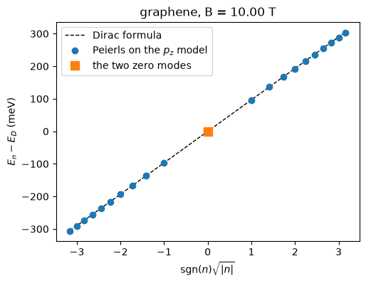

# Landau levels of graphene in a magnetic field

What does a uniform magnetic field do to the bands of a crystal? It bends the orbits of the
electrons into closed circles. Their energies are then quantized into Landau levels, and in
graphene these levels follow a law that is very different from that of a normal metal. For
massless Dirac electrons with velocity $v_F$,

$$E_n - E_D = \mathrm{sgn}(n)\, v_F \sqrt{2 e \hbar B |n|}, \qquad n = 0, \pm 1, \pm 2, \dots$$

so the levels grow as $\sqrt{|n| B}$, and there is a level exactly at the Dirac energy
$E_D$, for any field. This is what scanning tunnelling spectroscopy and cyclotron resonance
measure in graphene.

Here we compute the levels at 10 T from first principles. We take the DFT bands of
graphene, build a $p_z$ Wannier model from them, and put the field on its hoppings. Then we
compare the levels with the Dirac formula, at the velocity of the same bands.


```python
import matplotlib.pyplot as plt
from defuqumat import Calculator
from defuqumat.units import RY_TO_EV

graphene = Calculator.from_keywords(
    lattice='hexagonal', a=2.46, c=15.0, atoms=[('C', (0, 0, 0)), ('C', (1 / 3, 2 / 3, 0))],
    pseudos={'C': 'C.pbe-hgh.UPF'}, pseudo_dir='../tests/data/pseudo',
    ecut=50 * RY_TO_EV, kmesh=(12, 12, 1), smearing=0.01 * RY_TO_EV, smearing_type='mv')
ef = graphene.get_scf().fermi_energy * RY_TO_EV
pz = graphene.get_wannier(2, ['C:pz'], num_bands=16, dis_froz=(ef - 3, ef + 3), symmetry=False,
                          engine_options=dict(num_iter=1000, dis_num_iter=1000))
ll = graphene.get_landau_levels(B=10.0, wannier=pz, nlevels=44)
print(f'flux 1/{ll.flux[1]} per cell, B = {ll.field_tesla:.3f} T, v_F = {ll.dirac["v_F"]:.4e} m/s')
```

    flux 1/7891 per cell, B = 10.000 T, v_F = 8.4207e+05 m/s


## The magnetic cell

A field breaks the translations of the crystal, but a translation combined with a gauge
change is still a symmetry. These magnetic translations commute when the flux through the
cell they span is a whole number of flux quanta $\Phi_0 = h/e$. So, at a flux $p/q$ per
chemical cell, the magnetic cell is $q$ chemical cells, and the magnetic Bloch states live
in a zone $q$ times smaller. One flux quantum through the graphene cell is 78912 T, so 10 T
is $p/q = 1/7891$, a magnetic cell of 7891 cells and 15782 Wannier functions.

The field enters the model by the Peierls substitution. Each hopping $t(\mathbf R)$ picks up
the phase $e^{-i \int \mathbf a \cdot d\mathbf l}$ of the vector potential along the bond.
Then we look for the levels near $E_D$ with a sparse solver. The table compares each level
with the Dirac formula, at the velocity $v_F$ read from the zero-field bands of the same
model at $K$.


```python
row = ll.dirac['per_k'][0]
print(' n   E_n - E_D (meV)   Dirac (meV)   ratio')
for n in range(-6, 7):
    if n != 0:
        e = row['energies_ev'][n] * 1e3
        print(f'{n:3d}   {e:14.2f}   {e / row["ratios"][n]:11.2f}   {row["ratios"][n]:.5f}')
```

     n   E_n - E_D (meV)   Dirac (meV)   ratio
     -6          -237.16       -236.66   1.00211
     -5          -216.49       -216.04   1.00206
     -4          -193.62       -193.23   1.00198
     -3          -167.66       -167.34   1.00186
     -2          -136.87       -136.64   1.00168
     -1           -96.75        -96.62   1.00136
      1            96.48         96.62   0.99860
      2           136.33        136.64   0.99776
      3           166.85        167.34   0.99705
      4           192.54        193.23   0.99641
      5           215.14        216.04   0.99581
      6           235.54        236.66   0.99524


The ratio is close to one at $n = \pm 1$. It moves away from one slowly as $|n|$ grows,
and differently for electrons and holes. This is the band structure of graphene beyond the
Dirac cone: the bands bend away from a straight line, and not in the same way above and
below $E_D$. A pure Dirac model cannot give this.

What about $n = 0$? The Dirac formula puts one level exactly at $E_D$ in each valley, so
two states, with the whole weight of each on one sublattice.


```python
import numpy as np

print(f'zero level: {row["zero_level_ev"] * 1e6:.1f} ueV from E_D, {row["zero_multiplicity"]} states')
print('weight of the pair on the A and B sites:', np.round(row['zero_site_traces'], 6))
```

    zero level: -66.7 ueV from E_D, 2 states
    weight of the pair on the A and B sites: [1. 1.]


Two states sit at $E_D$, and together they carry one state on each sublattice. This is
the zero mode of graphene, and it does not move with the field. It is the reason the Hall
conductivity of graphene is $4(n + 1/2) e^2/h$, with the half.

We now plot the levels against $\mathrm{sgn}(n)\sqrt{|n|}$, where the Dirac formula is a
straight line.


```python
n = np.array(sorted(row['energies_ev']))
x = np.sign(n) * np.sqrt(np.abs(n))
fig, ax = plt.subplots(figsize=(5.5, 4))
line = np.linspace(-np.sqrt(10), np.sqrt(10), 2)
ax.plot(line, line * ll.dirac['E1_dirac_ev'] * 1e3, 'k--', lw=1, label='Dirac formula')
ax.plot(x, [row['energies_ev'][k] * 1e3 for k in n], 'o', label='Peierls on the $p_z$ model')
ax.plot([0], [row['zero_level_ev'] * 1e3], 's', ms=8, label='the two zero modes')
ax.set_xlabel(r'${\rm sgn}(n)\sqrt{|n|}$')
ax.set_ylabel(r'$E_n - E_D$ (meV)')
ax.set_title(f'graphene, B = {ll.field_tesla:.2f} T')
ax.legend()
plt.show()
```


    

    


## The exact route, at a very high field

The Wannier model keeps only the $p_z$ bands, and its Peierls phase is exact only when the
orbitals are much smaller than the magnetic length $\ell_B$. At 10 T, $\ell_B$ is 8.1 nm, so
this holds well. At thousands of tesla it does not, and there the code solves the
plane-wave problem in the magnetic cell directly, with no model. As a check of that route,
we switch off every potential and solve free electrons in the graphene box at $p/q = 1/10$.
The levels must be $(2n+1) B_{ph} + (2\pi m/c)^2$ in Rydberg units: Landau levels times the
standing waves along the box of height $c$.


```python
free = graphene.get_magnetic_bands(flux=(1, 10), kmesh=(1, 1), nbnd=6, free=True, local_only=True)
c = 15.0 / 0.529177210903
exact = sorted((2 * k + 1) * free.b_ph + (2 * np.pi * m / c) ** 2 for k in range(3) for m in (-1, 0, 1))
print(f'B = {free.field_tesla:.1f} T, B_ph = {free.b_ph:.6f} Ry')
print('computed / B_ph:', np.round(free.eigenvalues[0] / free.b_ph, 8))
print('exact    / B_ph:', np.round(np.array(exact[:6]) / free.b_ph, 8))
```

    B = 7891.2 T, B_ph = 0.033572 Ry
    computed / B_ph: [1.         2.46351843 2.46351843 3.         4.46351843 4.46351843]
    exact    / B_ph: [1.         2.46351843 2.46351843 3.         4.46351843 4.46351843]


The computed levels are the exact ones to the printed digits. With the potential of the
crystal switched on, the same route gives the Landau levels of the full plane-wave
Hamiltonian, which is the reference the Wannier route is compared with at high field.

The checks of these routes (the Hermiticity of the magnetic Hamiltonian, the plaquette
phase, the free Landau ladder, the Chern numbers of the levels) are in
`tests/unit/test_magnetic_peierls.py`, `tests/unit/test_magnetic_bloch.py` and
`tests/unit/test_magnetic_conventions.py`.
